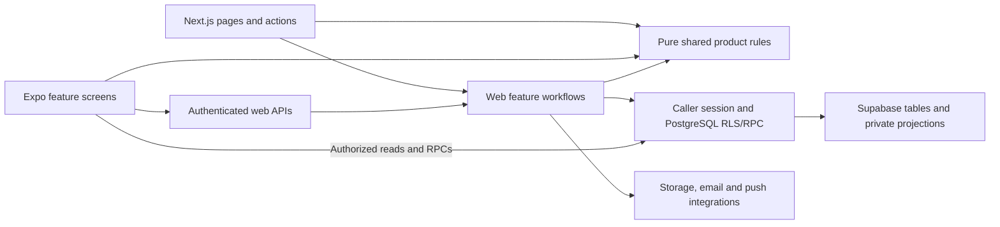

# Wedding Market architecture review and restructuring

October 26, 2026. The owner requested a review and restructuring of the database, file layout and overall application architecture while preparing the native launch. This batch restructures the existing product rather than changing its wedding/booking model. Validation and live release evidence are recorded below.

## Assessment and implemented changes

The database already represents the important relationships correctly after the October 19–20 repairs. The larger maintenance problems were the native monolith, business code mixed into a generic library folder, duplicated cross-platform rules, ambiguous old SQL entry points, unsafe schema-export tooling and missing dependency-boundary checks.

| Finding | Result |
| --- | --- |
| Native `App.tsx` contained 8,992 lines, including all screens, language copy, style definitions, navigation and application state. | The Expo entry is now three lines. Composition lives in `src/application`, screens in `src/features`, controls in `src/ui`, and copy/content/theme in separate modules. Styles are grouped by the feature that uses them. The largest native module is below 1,000 lines. |
| Web request, proposal, conversation, notification, vendor and media workflows were scattered through `lib`. | Maintained implementations now live in named `features` modules with explicit server/client/domain responsibilities. Routes/actions and consumers use those modules. Small compatibility exports preserve old imports. |
| Quote amounts, date validation and conversation closure were implemented separately on web/native. | Both use pure `shared/proposals`, `shared/calendar` and `shared/conversations` rules. Native numeric date formatting is preserved explicitly. Existing vendor pricing/service rules and notification contracts are grouped by domain in `shared`. |
| Root `migrations`/`sql` fragments competed with the newer versioned chain. | The five old schema/workflow fragments are under `supabase/legacy`, clearly marked historical. New schema work has one home: `supabase/migrations`. The recovered baseline remains immutable and must never be replayed over live data. |
| Three schema exporters duplicated code and disabled certificate checks globally/per connection. README described the wrong transport. | They delegate to one PostgreSQL exporter using a read-only transaction, verified remote TLS, URI TLS-option sanitization, timeouts and sanitized errors. TLS-policy regressions cover insecure overrides. |
| New code could accidentally import a server workflow into a browser/native module or grow another screen monolith. | `npm run architecture:check` checks runtime dependency boundaries, cycles, migration versions and native module size; it is part of root `npm run check`. |
| Missing-table UI told clients/vendors to run old SQL installation fragments. | Those fallback states now show an EN/ES availability/support message. Database administration details no longer appear in that user flow. |

The extraction receipt preserves the original hashes of 63 top-level native declarations copied into 27 initial modules. Resources were subsequently split further, imports grouped, composition renamed to `application` to avoid Expo Router's reserved `src/app` convention, and the duplicated pure rules intentionally consolidated. The receipt describes that extraction step, not a claim of identical final bundle bytes. Final checks exercise the maintained code.

## Application boundaries



Keep Next.js routing, redirects, transport authentication, cache invalidation and route-local form composition in `app`. Feature server modules own workflows and receive the authenticated Supabase client. Browser transports belong in `features/*/client`; the saved-vendor summary fetcher is a public HTTP client, not a server module. `lib` keeps infrastructure and compatibility entry points. `shared` remains dependency-free product code; it does not import Next.js, React, Supabase clients, Node APIs, native SDKs or credentials.

The native app still uses its existing authenticated API and direct RLS-protected Supabase paths. This release does not introduce a second backend, a new ORM, a router migration or a replacement authentication system. PostgreSQL rechecks authorization and transaction rules even when client-side validation passes.

## Live database review

The owner switched to the account with **WedMarket**, project `aousexbvujjnvbudpsmz`, organization **CR Wedding Destination**. Catalog-only SELECTs were executed in that project. No application/customer records were exported and no production DDL, data updates, grants or account changes were performed.

Live PostgreSQL is **17.6**. The catalog has **23 public tables, 8 views, 324 columns, 72 constraints, 69 indexes, 86 policies and 38 non-extension public functions**. Every public table has RLS enabled. The catalog queries found no anonymously writable table without RLS and no public security-definer function lacking a fixed search path. Those checks do not substitute for full authorization testing; the regression suite separately exercises real PostgreSQL policies and transactions with synthetic records.

The local replay of all eight migrations matches the live columns/defaults/nullability, constraints, indexes, policies, view definitions/options, and function body fingerprints/settings. The comparison normalizes carriage-return line endings and PG18's separately cataloged NOT NULL constraints; nullability itself is compared explicitly. All eight ledger records match current source either exactly, after line-ending normalization, or through the recorded reviewed SHA-256. This is stronger evidence than comparing migration version numbers alone. Object grants/ownership, triggers, Auth configuration, storage policies, restore readiness and all production data invariants are outside this specific catalog comparison; historical checks remain historical.

Evidence: [live structural inventory](live-database-structure.json), [catalog-only query](live-catalog-query.sql), [object comparison](catalog-comparison.json), [migration comparison](migration-drift-check.json). Raw recorded SQL and full local/live catalog inputs are kept in ignored `.cache/restructure-2026-10-26`; they contain schema metadata, not customer records.

### Core relationships to preserve

- Auth users have profiles; signup country is the contact country. Weddings remain in Costa Rica.
- Vendor owners manage a vendor with category, location, amenities, pricing, availability, media and team details.
- `rfqs` is the shared wedding brief; `rfq_invites` identifies each private `(request, vendor)` conversation and carries its booking/consent state.
- `quotes` stores immutable proposal revisions scoped to that conversation. Version allocation and acceptance are database-checked; messages survive revisions and may precede the first proposal.
- `quote_messages` links directly to the vendor thread while retaining legacy proposal linkage where present.
- Each invited vendor can be accepted independently. Contact disclosure, reviews and private messages follow that vendor's booking; accepting one provider does not close another provider's conversation.
- The protected `rfqs_visible` and `thread_vendors` security-barrier projections deliberately apply membership/contact masking. Do not convert every view to the same security mode without evaluating its contract.

Three foreign keys have no matching full leading index according to the diagnostic query: the two language lookups and the three-column accepted-quote relationship. The thread already has its request/vendor primary key and an accepted-quote index. Additional indexes need query-plan/workload evidence; no speculative index or table rename was applied. Historical duplicate/redundant indexes can be evaluated with usage and dependency checks in a separate tuning migration.

No database rebuild was justified by this inspection. Destructive renaming, dropping legacy fields or replaying a schema baseline would add compatibility/data risk without fixing the demonstrated maintenance problems. The existing migration chain was made reproducible and unambiguous instead.

## Running and extending the project

Use Node 22 or supported Node 24. The machine's default `node` changed to Node 20 during this task; that caused missing-native-WebSocket test failures. The final web suite/build used the bundled Node **24.19.0** and passed. Do not add an unrelated WebSocket workaround to compensate for an unsupported runtime.

From the repository root:

```powershell
npm run architecture:check
npm run db:inspect
npm run test:database
npm run test:tooling
npm test
npm run check
```

From `mobile`, run `npm run check`, `npm run export:android` and `npm run export:ios`. The exports prove bundle generation, not signing, production configuration or real-device behavior. Actual EAS source archives must still include sibling `shared` modules and exclude server sources/secrets.

Current validation: **71 web tests, 27 PostgreSQL checks, 49 native tests and 9 tooling tests pass**, with both typechecks/linters, architecture checks, the production web build, online Expo compatibility and Android/iOS Hermes exports. Initial Windows sandbox output-directory failures were retried successfully outside the sandbox. No failure was counted as a pass.

### Further product/reliability work

The restructuring gives this work clear ownership; it does not claim it already exists:

- Launch branding still needs approved vector/production exports, and mobile launch still needs self-service deletion, user-content reporting/blocking, verified support/privacy declarations, signing/push proof, native screenshots and device acceptance. See [the launch package](../mobile-launch-2026-10-26/README.md).
- Notification persistence/delivery still uses existing best-effort delivery after business persistence; a durable outbox/retry worker requires its own tested design and operational rollout.
- Vendor media has both relational and legacy JSON representations. Consolidation needs a compatibility plan and parity/backfill checks before either representation can be removed.
- Some route-local web signup/profile forms and the admin blog editor remain large. They are isolated from the extracted core workflows; further component/hook splits should follow actual feature changes and UI acceptance, rather than a mechanical rewrite.
- Database backup restoration and other previously recorded infrastructure handoffs remain separate. A matching metadata replay is not a production backup or a restore rehearsal.

## Release

Prepared against verified live application commit `4691853c1c480306f229273529214af51e05a162`. Application deployment uses the existing restricted gateway, preserves the preceding release, and must produce an exact target-commit receipt plus independent public checks. This application release needs no schema migration. Native source changes require a future signed binary; a website deployment does not update installed iOS/Android apps.

The release receipt and public verification are recorded alongside this review once complete.

## Reference guidance

[Supabase migration workflow](https://supabase.com/docs/guides/deployment/database-migrations) supports the single versioned migration chain. [Supabase RLS guidance](https://supabase.com/docs/guides/database/postgres/row-level-security) informs the authorization boundaries. [PostgreSQL index documentation](https://www.postgresql.org/docs/current/sql-createindex.html) explains why indexes should follow actual access patterns rather than being added indiscriminately. These references support the design; current project findings come from the source, tests and saved live catalog evidence above.
